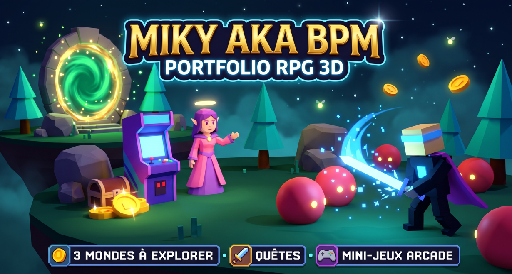

# 🎮 Miky AKA BPM — Portfolio RPG 3D Interactif



> **Explorez mon univers de Développeur Web Front-End sous forme de jeu de rôle 3D directement dans votre navigateur !**

🔗 **[Jouer au Portfolio en ligne (GitHub Pages)](https://brival-m.github.io/portfolio/)**

---

## ✨ À propos du projet

Plutôt qu'un portfolio classique, j'ai conçu une expérience **RPG 3D interactive** construite avec **Three.js** et **Tailwind CSS**. Incarnez mon avatar, explorez un archipel flottant, dialoguez avec **Lyra** (dotée d'une narration vocale) et relevez différents défis pour débloquer mes réalisations.

### 🗺️ Les Mondes & Quêtes à explorer

* **🏝️ L'Archipel Central (Hub) :** Point de départ de l'aventure. Collectez les **10 pièces d'or** dispersées sur l'île pour ouvrir le premier portail dimensionnel, discutez avec **Lyra** ou testez vos réflexes sur la **Borne d'Arcade**[cite: 2].
* **🌲 Monde 1 — La Forêt RPG :** Affrontez les **10 créatures** à l'épée pour débloquer les **6 projets de ma formation OpenClassrooms**[cite: 2] (*Booki, OhMyFood, La Chouette Agence, Kanap, Piiquante, Groupomania*)[cite: 2].
* **💎 Monde 2 — Le Sanctuaire Cyber-Lab :** Synchronisez les **5 cristaux d'énergie** pour révéler mes **projets personnels BPM**[cite: 2] (*BPM-Core Audio Converter WAV2MP3, BASE64 Converter by BPM, Organisateur*)[cite: 2].
* **🔥 Monde 3 — Le Temple Céleste :** Allumez les **4 braseros** pour découvrir mon parcours, mes compétences et mes passions[cite: 2].
* **⚔️ Monde 4 — L'Arène Infinie :** Un mode survie sans fin avec vagues d'ennemis et monstres élites pour faire grimper votre score et gagner des pièces bonus[cite: 2].
* **🕹️ Salle d'Arcade & Mini-Jeux :** Deux mini-jeux intégrés (*BPM Rhythm Beat* et *Cyber Memory Code*) avec effets sonores générés en temps réel[cite: 2].

---

## 🎮 Commandes du jeu

| Action | Clavier (PC) | Souris / Tactile (Mobile) |
| :--- | :--- | :--- |
| **Se déplacer** | `Z` `Q` `S` `D` ou `Flèches`[cite: 2] | Clic au sol ou Joystick virtuel[cite: 2] |
| **Tourner la caméra** | — | Cliquer-glisser horizontalement[cite: 2] |
| **Attaquer à l'épée** | `F` ou `Espace`[cite: 2] | Bouton **Épée** en bas à droite[cite: 2] |
| **Interagir / Entrer** | `E` ou `Entrée`[cite: 2] | Bouton contextuel à l'écran[cite: 2] |

---

## 🛠️ Technologies utilisées

* **Rendu 3D :** [Three.js (r128)](https://threejs.org/)[cite: 2]
* **Audio & Synthétiseur :** [Tone.js](https://tonejs.github.io/) & Web Speech API (synthèse vocale)[cite: 2]
* **Interface & Style :** HTML5, Tailwind CSS, Font Awesome[cite: 2]
* **Logique :** JavaScript Vanilla (ES6+)[cite: 2]

---

## 🚀 Lancer le projet en local

Aucune installation ou dépendance n'est requise :

1. Clonez le dépôt :
   ```bash
   git clone [https://github.com/BRIVAL-M/portfolio.git](https://github.com/BRIVAL-M/portfolio.git)
